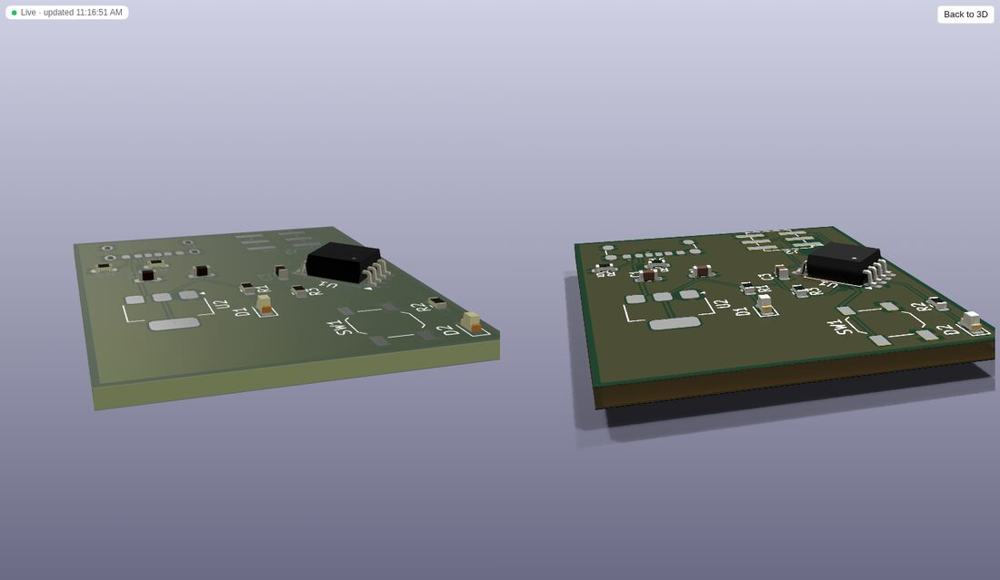

# dsh-kicad

[English](README.md) | 中文

为 [DeepSeek Harness](https://github.com/deepseek-ai/deepseek-harness)（dsh）提供 KiCad 支持的原生插件 bundle：让 agent 读取、修改并检查 KiCad 原理图，而设计是否正确由 KiCad 自己（`kicad-cli`）判定。

> 开发者预览版。基于 dsh `0.2.1-rc.2` 与 KiCad `10.0.7` 构建和测试。dsh 插件 API 尚未稳定，所有包都在 `engines.dsh` 中锁定 `>=0.2.1-rc.2 <0.3.0-0`。

## 功能

| 能力 | 说明 |
|---|---|
| **工具**（`kicad_*`） | `doctor`（检查本机是否就绪：kicad-cli 与 KiCad 8+、库、Python，附修复方法和安装命令）、`read_schematic`、`list_components`、`get_symbol_pins`、`list_nets`（KiCad 网表）、`search_symbols`（已安装符号库）、`erc`、`drc`、`render`（SVG；模型支持图片时附带 PNG 图片；电路板可从任意方向和角度渲染 KiCad 的 3D 视图）、`export`（网表/BOM）、`simulate`（用 ngspice 做 SPICE 验证：工作点、瞬态与交流分析，需求以断言形式由工具依据数值判定，见[仿真验证](#仿真验证)）、`sim_model`（列出模型文件或目录中的 SPICE 模型及其引脚）、`export_fab`（Gerber/钻孔/坐标/BOM 压缩包及 3D 预览，KiCad 判定电路板就绪前拒绝导出，见[制板输出](#制板输出)）、`fab_preset`（JLCPCB/PCBWay 设计规则）、`create_schematic`，以及原子批量编辑 `edit_schematic`（增删移动元件、设置值/封装/属性、导线、标签、电源符号、结点、不连接标记、绕开元件和其他网络自动布线的引脚到引脚导线、引脚到网络的连接，以及按功能分区布局：带标题的功能块框、连同导线一起移动元件或整个功能块、图纸尺寸与标题栏）；电路板有 `read_pcb`（外框、层、设计规则与网络类、带 courtyard 和焊盘网络的封装、覆铜区、DRC 给出的未布线数）和原子批量编辑 `edit_pcb`（板框与安装孔、移动/翻面/锁定封装、写入 `.kicad_pro` 的设计规则与网络类、以焊盘为端点的走线、过孔、覆铜区、禁布区、丝印文字与位号、按 uuid 删除）；以及 `update_pcb`——无界面地完成 KiCad 的“从原理图更新 PCB”：新板使用 KiCad 的空板、默认叠层和占位板框；已有电路板上已放置的封装保持原位，新封装放在板框旁等待布局，网络、值和字段随原理图更新；无法上板时拒绝执行并列出需修正的 `REF:PIN`，结果由 KiCad 的原理图一致性检查判定；以及 `autoroute`——用 [Freerouting](https://github.com/freerouting/freerouting) 自动布线，保留手工布好（锁定）的和已有的走线，重新填充覆铜，以 KiCad 的 DRC 结论为准（见[布线](#布线)）。未修改的文件文本逐字节保持不变。 |
| **策略** | 设计修改走 dsh 审批（`ask`）；写操作被单调 guard 限制在会话工作目录内；每次成功修改后自动运行 KiCad ERC（原理图）或 DRC（电路板修改或应用板厂预设后，先重新填充覆铜；`update_pcb` 之后另报原理图一致性问题数）并把结论附加到工具结果；系统提示中注入稳定的 KiCad 工作规范，以及动态的“当前目录中的 KiCad 工程 + 最近一次 ERC/DRC”上下文。 |
| **技能** | `kicad-agent-workflow`、`kicad-erc-triage`、`kicad-drc-triage`、`kicad-schematic-design`、`kicad-simulate`。 |
| **命令** | `/erc`、`/drc`、`/bom`、`/simulate`（不经过模型，作用于工程根设计）、`/kicad-fab`（制板压缩包）、`/kicad-render`、`/kicad-doctor`（环境检查）、`/kicad-install`（安装 KiCad 或 Freerouting 自动布线器，见下文）。 |
| **Agent 预设** | `eda`：与 standard 类似的工具集 + 电子设计人设。KiCad 工具为全局注册，任何预设都可使用。 |
| **Web 界面** | 右侧边栏 `*.kicad_sch` / `*.kicad_pcb` 查看器，两种模式：**交互**——内嵌 [KiCanvas](https://github.com/theacodes/kicanvas)（层次图纸、查看元件/封装/网络、图层开关、KiCad 或 Witch Hazel 主题、文件变化时自动刷新）；**SVG**——kicad-cli 渲染（平移缩放、多图纸、渲染按钮，PCB 文件变化时自动重新渲染，也是交互模式失败时的自动回退）；电路板还有仿照 KiCad 3D 查看器的 **3D** 模式（见 [3D 视图](#3d-视图)）；ERC/DRC、原理图修改与环境检查的对话卡片；sidecar（kicad-cli 路径、Python，以及 KiCad 环境检查和 **安装 KiCad**）与策略（审批、自动 ERC、自动渲染）的设置页。KiCad 缺失或版本过低时，查看器和失败的工具卡片会显示带 **安装 KiCad** 按钮的提示。 |
| **独立 MCP server** | Python sidecar 通过 stdio 说 MCP 协议，Claude Code 或 RL 环境可以不经 dsh 直接复用同一套工具。 |
| **KiCad 端（可选）** | IPC 插件，工具栏按钮 “Open in DSH”。 |

## 架构

```
dsh-kicad-bundle  (cordis.patch.yml：全局行 + presets/eda.patch.yml)
├─ dsh-kicad-bridge     Host  ctx.kicad 服务；通过 ctx.subprocess 管理 Python sidecar，以 MCP 通信
│    └─ sidecar/        Python ≥3.10，核心仅用标准库：无损 .kicad_sch S 表达式编辑、符号库、引脚几何、
│                       kicad-cli（ERC/DRC/网表/BOM/SVG）、制板输出；可选 extra：png（cairosvg）、ipc（kicad-python）
├─ dsh-tool-kicad       Host  kicad_* 工具（defineTool），路径相对会话工作目录解析
├─ dsh-kicad-policy     Host  tools.guard + tools/pre-execute（ask/deny）+ tools/post-execute（自动 ERC/DRC）+ 提示词 section/context
├─ dsh-kicad-skills     Host  技能 provider + /erc /drc /bom /kicad-fab /kicad-render
└─ dsh-client-ui-kicad  Client sidebarRightTabs 类型 + tool.call.toolview 行 + plugins.row.config 设置页
kicad-plugin/           KiCad IPC 插件（"Open in DSH"）
market/                 插件市场索引示例
```

设计取舍：

- **文件优先、可 headless。** 以文件方式编辑 `.kicad_sch`（S 表达式），用 `kicad-cli` 判定，不依赖 KiCad GUI。IPC API（`kipy`）只是可选的实时通道（`ipc_status`），因为它需要 GUI 运行且同一时间只允许一个客户端。
- **Python sidecar** 而非 Node 直连 IPC：KiCad IPC 是 NNG + protobuf，官方绑定只有 Python。
- **由 KiCad 判定。** ERC/DRC 结论来自 `kicad-cli`，不让模型自判。
- **与 dsh 的耦合集中。** 每个包只通过一个适配模块（`src/dsh.ts`、`src/client/dsh.ts`）接触 dsh API；前端只用公开接缝（`sidebarRightTabs`、keyed slots、`remote.workspaceFiles`、`remote.commands`、配置表单），不 import 任何 dsh Client 包——这也是 dsh 对第三方 UI 插件的要求。

## 环境要求

- dsh `>=0.2.1-rc.2 <0.3`（`npm i -g @deepseek-ai/dsh`），Node `>=22.19`，pnpm 11（源码构建时）
- `PATH` 上的 Python `>=3.10`（`python3`；Windows 为 `python`），核心无需任何 Python 包
- KiCad 8+ 与 `kicad-cli`（已在 10.0.7 测试）。查找顺序：设置项、`$KICAD_CLI`、`PATH`、macOS/Windows 安装目录、Flatpak `org.kicad.KiCad`
- 可选：`rsvg-convert`、ImageMagick 或 `png` extra（PNG 渲染）；`ipc` extra（IPC 通道）；[ngspice](https://ngspice.sourceforge.io/)（`PATH` 上的 `ngspice`，或 `$NGSPICE`，或 KiCad bridge 的 `ngspice` 设置），供 `kicad_simulate` 使用

### 检查环境与安装 KiCad

**Plugins → KiCad → KiCad bridge** 页面显示环境检查：每一项（kicad-cli、KiCad 版本 ≥ 8、符号库与封装库、Python ≥ 3.10、可选的 KiCad 3D 模型库、PNG 光栅化工具和 kicad-python）都有状态和修复方法。对话里用 `/kicad-doctor` 查看同样的结果，模型可调用 `kicad_doctor`；因缺少 KiCad 而失败的工具会在错误信息里给出安装命令。

KiCad 缺失或版本过低时，该页面（以及查看器里的提示）会列出本机可用的安装方式：

| 平台 | 方式 | 能否由 dsh 执行 |
|---|---|---|
| Fedora | `sudo dnf install -y kicad` | 否：需要 root，提供 **复制命令** |
| Ubuntu 及衍生版 | KiCad PPA：`sudo add-apt-repository -y ppa:kicad/kicad-10.0-releases && sudo apt-get update && sudo apt-get install -y kicad` | 否（root） |
| Debian | `sudo apt-get install -y kicad` | 否（root） |
| Arch | `sudo pacman -S --needed kicad kicad-library` | 否（root） |
| openSUSE | `sudo zypper install kicad` | 否（root） |
| 装有 flatpak 的任意 Linux | `flatpak remote-add --user … flathub` + `flatpak install --user flathub org.kicad.KiCad` | 可以，按用户安装、无需 root（约 1.5 GB） |
| macOS | `brew install --cask kicad` | 可以（需已安装 Homebrew） |
| Windows | `winget install --id KiCad.KiCad -e` | 可以（需有 winget，Windows 可能弹出授权） |
| 所有平台 | kicad.org 安装包 | 链接 |

点击 **安装…** 并确认显示的完整命令之前，不会执行任何操作。dsh 从不执行 `sudo`：需要 root 的方式只展示命令，请在终端中自行执行后点 **重新检查**。安装过程显示日志、可随时停止；结束后 bridge 会重启 sidecar 并重新检查，新的 kicad-cli（包括通过 `flatpak run --command=kicad-cli org.kicad.KiCad` 运行的 Flatpak 版）无需重启 dsh 即可使用。对话中：`/kicad-install` 列出安装方式，`/kicad-install flatpak --yes` 执行其中一种，`/kicad-install status` 查看进度。

设置页本身没有会话，检查会借用你最近的会话执行，因此请先打开或新建一个会话。

## 安装

### 从源码（当前可用）

```sh
git clone https://github.com/LuYanFCP/dsh-kicad && cd dsh-kicad
pnpm install && pnpm run build
dsh plugin --profile web add "$PWD/packages/kicad-bundle"
dsh web
```

`dsh plugin … add <目录>` 会以 link 方式安装；子包通过本仓库的 `node_modules` 解析，`@deepseek-ai/*` 的 import 由 dsh 映射到正在运行的安装。修改代码后需重新构建并重启 dsh。也可以在 Web 界面 **Plugins → Install** 中填入同一绝对路径。

### 直接粘贴仓库地址（最简单）

在 dsh 里 **Plugins → Add plugin**，填 `https://github.com/LuYanFCP/dsh-kicad` 后安装（或运行 `dsh plugin --profile web add https://github.com/LuYanFCP/dsh-kicad`）。仓库根目录本身就是 `dsh-kicad` bundle，会加载预构建好的 `dist/dsh-kicad`。在地址后加 `#<tag 或 commit>` 可以固定版本。

### 通过插件市场（在 dsh 里搜索安装）

dsh 通过**插件市场**检索插件：添加一次市场索引（JSON）即可搜索。本仓库发布了一个索引。

1. **Plugins → Experimental plugins → More → Custom plugin markets** 打开，出现 **Discover** 标签。
2. **Discover → Add index source** 填入：`https://raw.githubusercontent.com/LuYanFCP/dsh-kicad/main/market/index.json`
3. 搜索 `kicad`、`原理图`、`电路板`、`circuit board` 等，点 **Install → Enable now**，无需重启。

市场条目从固定的 Git commit 安装 `dist/dsh-kicad`：由 `pnpm run dist`（`scripts/pack-dist.mjs`）生成的单个自包含包。也可以直接安装：

```sh
dsh plugin --profile web add "git+https://github.com/LuYanFCP/dsh-kicad.git#<commit>&path:/dist/dsh-kicad"
```

发布新版本：`pnpm run dist` 并提交，然后在 `market/index.json` 中用该 commit 增加一个版本，并用 `node market/validate.mjs <dsh>/node_modules/@deepseek-ai/dsh-plugin-market-index` 校验。

## 使用

1. 打开工作区包含 KiCad 工程的会话（侧栏 **Add workspace**），可选择 **EDA agent** 预设。
2. 例如提问：*“在 U1 旁边的 +3V3 与 GND 之间加一个 100 nF 去耦电容，并让 ERC 通过。”* agent 会先读取设计，再发送一次 `kicad_edit_schematic` 批量修改（由你审批），并读取策略自动附加的 ERC 结论。
3. 从 **Workspace files** 打开 `.kicad_sch`：KiCad 标签页显示渲染结果，agent 每次修改后自动刷新；**Render** 按需重新渲染。
4. `/erc`、`/drc`、`/bom` 不经过模型直接运行。
5. 设置位于 **Plugins → KiCad → KiCad bridge / KiCad policy**。

### 电路板布局

`kicad_update_pcb` 生成电路板后，一个 `kicad_edit_pcb` 操作 `auto_place` 即可按原理图的功能块（`add_block` 画的框；没有功能块时按图纸页，再不然按网络连接）完成布局：同一功能块的元件放在一起，连接器放在板边并朝外（封装上的 "PCB Edge" 标记落在板边），去耦电容紧靠其 IC 的电源引脚，晶振紧靠其 IC，功率器件周围留出空间，板框按元件大小确定（已画好的板框则保留，元件放在其中）。`place_block` 把单个功能块放到指定位置或矩形内。之后 `kicad_read_pcb` 报告 courtyard 重叠、板框外的封装和飞线总长，`kicad_render` 加 `view: "3d"` 可查看效果。在 usb-attiny85 电路板上：无 courtyard 重叠，所有封装都在板框内，USB-C 位于板边，飞线总长 214 mm，随机摆放为 345 mm（[详情](docs/pcb-architecture.md#placement-12)）。

### 布线

`kicad_autoroute {pcb, nets?, exclude_nets?, passes?, timeout?}` 把电路板写成 Specctra 设计文件，无界面运行 Freerouting，只把新增的走线和过孔加回电路板，从不移动封装。板上已有的走线和过孔都作为固定布线保留，因此 agent 先手工布关键网络（电源、USB 或差分对、晶振：`kicad_edit_pcb` 的 `add_track` / `add_via`，加 `locked: true`），其余交给布线器完成。之后由 `kicad-cli pcb drc --refill-zones --save-board` 重新填充并保存覆铜（例如双面 GND 铺铜），其结论（未布通数、DRC 错误、原理图一致性）就是结果。可以在 dsh 中取消，到达 `timeout`（默认 300 秒）时停止并保留已布好的线；设计文件、会话文件和日志保存在 `<工程>/.dsh-kicad/autoroute/`。仍有未布通的连接时，结果会建议手工补线，或者对用 `auto_place` 布局的电路板先清除走线（`remove_tracks`）、再以更大间距（`gap: 2, group_gap: 4`）重新布局：usb-attiny85 示例这样即可全部布通。

Freerouting（GPL-3.0）是独立的 Java 程序，不随插件分发。`/kicad-doctor` 检查 Java 与 Freerouting；`/kicad-install freerouting --yes` 把固定版本的发布 jar（2.5.0，约 65 MB，校验 SHA-256）下载到你的数据目录（Linux 上为 `~/.local/share/dsh-kicad/freerouting`），从不使用 `sudo`。Freerouting 2.5.0 需要 **Java 25+**：doctor 会列出包管理器命令或 [Temurin JRE](https://adoptium.net/temurin/releases/?package=jre)。bridge 的 `java` 与 `freerouting` 设置可以指向已有的 Java 或 jar。

### 仿真验证

`kicad_simulate {path, analyses?, assertions?, probes?, timeout?}` 验证原理图“做什么”，而不只是“怎么连”。KiCad 导出 SPICE 网表（`kicad-cli sch export netlist --format spice`，读取元件的 `Sim.*` 属性，所以这里仿真过的设计在 KiCad 自带的 Simulator 里也能仿真），ngspice 无界面运行，每条需求写成断言，由工具依据数值判定，就像 ERC/DRC 由 KiCad 判定一样：模型不做裁决。

- 分析：`op`（直流工作点，默认）、`tran {stop, step?}`、`ac {start, stop, points?}`；每次调用每种至多一个。
- 探针：`V(net)`、`V(a,b)`、`I(R1|C1|L1|D1|V1)`。断言：`{probe, min?, max?, equals? + tol | tol_pct, abs?, measure?, at?, from?, to?, ref?}`，数值用 SPICE 写法（`10k`、`100n`、`3.3`、`20m`）。测量项：`final`、`initial`、`max`、`min`、`mean`、`rms`、`pp`、`at`（瞬态）；`gain_db`、`phase_deg`、`peak_gain_db`、`lowpass_cutoff_hz`、`highpass_cutoff_hz`（交流，`ref` 用于相对输入的增益）。
- 示例：3.3 V 电源轨 `{probe: "V(3V3)", min: 3.2, max: 3.4}`，LED `{probe: "I(D1)", min: "5m", max: "15m", abs: true}`，低通滤波器 `{probe: "V(OUT)", analysis: "ac", measure: "lowpass_cutoff_hz", equals: 1000, tol_pct: 5}`。
- 电路需要接地网络、来自 `Simulation_SPICE` 的信号源（`VDC`、`VSIN`、`VPULSE`、`IDC`），以及每个关键元件的模型：R、C、L 按其值仿真；二极管和 LED 需要 `set_sim_model {reference, device: "D", params}`（即隐藏属性 `Sim.Device`）（否则工具拒绝运行，因为缺少它时 KiCad 会把二极管接反）；IC、稳压器和三极管需要厂商模型（见下）。没有模型的元件会被排除在电路之外，并列在结果里。
- **厂商模型。** `kicad_sim_model {path, name?}` 列出模型文件（或目录下所有模型文件）中的 `.subckt`（带引脚名和上方的注释）与 `.model`。`kicad_edit_schematic` 的 `set_sim_model {reference, library, name, pins?}` 把其中一个绑定到元件：写入隐藏属性 `Sim.Library`（相对工程路径）、`Sim.Name`、`Sim.Device` 和 `Sim.Pins`，按名称匹配符号引脚与模型引脚；匹配不了时拒绝并给出两边的引脚列表（请传 `pins: {"1": "GND", "2": "OUT", "3": "IN"}`），因为 KiCad 会照单全收错误的 `Sim.Pins` 并仿真出错误的电路。`{reference, device: "D", params}` 不需要文件，直接设置内置器件。模型来自你提供的文件，插件不内置任何模型，也要求 agent 不得编造。子电路内部节点不会出现在结果里。
- **容差分析。** `monte_carlo: {runs?, seed?, tolerances?, distribution?, min_pass_rate?}` 在 R、C、L 的值（默认 ±5 %、±10 %、±10 %；`tolerances: {R: 1, C1: "20%", V1: 2}`，百分比，按元件字母或位号；V、I 源按直流电平）随机取值的情况下重复仿真，均匀分布在容差内，或高斯分布（3σ 等于容差），并按断言报告成立的次数、最小/平均/最大值和第一次失败的取值。有随机种子，可重复；`min_pass_rate`（默认每次都要成立）可接受低于 100 % 的比例。只有普通的 R、C、L 值和电源电平会变化，厂商模型内部的参数不变。
- **需求跟着工程走。** `save_spec: true` 把本次调用的分析、断言和 `monte_carlo` 写入 `<原理图名>.sim.json`（普通 JSON：`analyses`、`assertions`、`probes`、`monte_carlo`、`timeout`；`spec` 可指定别的文件）。之后的 `kicad_simulate` 调用和 `/simulate` 在该文件存在时直接使用它，改动后无需重新输入就能按所有已保存的需求重新验证；调用中明确给出的参数会替换文件里的同名键。
- ngspice 需要另行安装：`/kicad-doctor` 会检查并列出本机的安装命令（`sudo dnf install ngspice`、`sudo apt-get install ngspice`、`brew install ngspice` 等）。网表、仿真文件、rawfile 和日志保存在 `<工程>/.dsh-kicad/sim/<名称>/`。`/simulate` 不经过模型，按工程已保存的需求仿真（没有保存时做一次工作点仿真）；`kicad-simulate` 技能指导 agent 把需求写成断言并迭代修改。
- 它无法回答的：固件行为、没有 SPICE 模型的元件、信号完整性、EMC 和热。

### 3D 视图

打开 `.kicad_pcb`，在“交互 / SVG”旁选择 **3D**，相当于 KiCad 的“视图 → 3D 查看器”。Host 把电路板导出为二进制 glTF 场景（`kicad-cli pcb export glb`，含铜皮、焊盘、覆铜、阻焊、丝印和封装的 3D 模型），存放在 `<工程>/.dsh-kicad/render/<板名>/`，按电路板内容缓存，再次打开即时显示。查看器通过 `remote.workspaceFiles` 读取（原始字节；超过 dsh 32 MiB 整文件上限时按 2 MiB 分段读取），用 three.js 显示：拖动旋转，右键或 Shift 拖动平移，滚轮缩放；**顶面 / 底面 / 前 / 后 / 左 / 右 / 轴测**、**透视 / 正交**、**元件**开关和**重置视角**。电路板变化时（agent 修改、KiCad 保存）静置一秒后重新导出，视角保持不变；导出失败时保留上一次的模型并说明原因。



**KiCad 渲染**按钮用 KiCad 自己的渲染器渲染当前视角（`kicad-cli pcb render --quality high`，几秒钟），把轨道相机换算为 `--rotate` / `--zoom` / `--pivot` / `--perspective`，得到与 KiCad 完全一致的效果。浏览器不支持 WebGL 时，3D 模式显示这种渲染图，视图按钮同样可用。

three.js（约 645 KB，gzip 后 163 KB）是单独的客户端分块 `lib/client.three.js`，第一次以 3D 模式打开电路板时才由 dsh 加载；主客户端模块只增加约 28 KB。

模型也能从任意角度查看：`kicad_render {view: "3d", side?, rotate?: "-45,0,45", zoom?, pivot?, perspective?, quality?: "basic" | "high"}`（默认值和返回结果不变；在对话中用 `/kicad-render <板> --3d --rotate=-45,0,45`）。

**KiCad 3D 模型库。** 元件外形来自 KiCad 的 3D 模型库（`${KICAD10_3DMODEL_DIR}`），多数 Linux 发行版把它单独打包。`/kicad-doctor` 会检查它（变量按 KiCad 的方式解析：环境变量，其次“首选项 → 配置路径”，最后是内置默认路径）；封装引用的模型找不到时，3D 视图会显示带修复方法的提示：

| 平台 | 3D 模型库 | dsh 能否代为执行 |
|---|---|---|
| Fedora | `sudo dnf install -y kicad-packages3d` | 否：需要 root，提供 **复制命令** |
| Debian、Ubuntu（含 KiCad PPA） | `sudo apt-get install -y kicad-packages3d` | 否（root） |
| Arch | `sudo pacman -S --needed kicad-library-3d` | 否（root） |
| openSUSE | `sudo zypper install kicad-packages3D` | 否（root） |
| Flatpak 版 KiCad | `flatpak install --user flathub org.kicad.KiCad.Library.Packages3D//stable` | 可以，按用户安装（下载约 640 MB） |
| macOS | 已包含在 KiCad.app 中（DMG 与 Homebrew cask）；`brew reinstall --cask kicad` 可恢复 | 可以，需 Homebrew |
| Windows | 完整安装包（以及 `winget install KiCad.KiCad`）已包含；保留“3D models”组件 | 链接 |
| 所有平台 | 下载与 KiCad 版本对应的 [kicad-packages3D](https://gitlab.com/kicad/libraries/kicad-packages3D/-/tags) 压缩包，再设置 `KICAD10_3DMODEL_DIR` | 链接 |

发行版软件包下载约 270 MB，安装后约 3.1 GB。没有它时，3D 视图和渲染图只显示带焊盘、铜皮和丝印的裸板。

### 制板输出

`/kicad-fab [board.kicad_pcb] [--preset jlcpcb|pcbway] [--force] [--step] [--ipc2581] [--odb]`（agent 使用 `kicad_export_fab`）先由 KiCad 判定电路板：存在 DRC 错误、未布通的连接、原理图一致性（parity）问题（原理图与电路板在同一目录时检查），或在指定预设时违反该板厂的工艺限制，都会拒绝导出，且不写任何文件。`--force` 强制导出，结果和 `fab-manifest.json` 会注明这一点。

输出位于 `<工程>/fab/<预设或 kicad>/`：铜层、阻焊、钢网、丝印与 Edge.Cuts 的 Gerber 及 Gerber job 文件；Excellon 钻孔文件及 Gerber X2 钻孔图；`assembly/` 中的坐标文件和 BOM（`--preset jlcpcb` 时另有 JLC 格式的 BOM/CPL）；`preview/` 中的正反面 3D PNG；以及包含除预览外全部文件的 `<板名>-<预设或 fab>.zip`。

`kicad_fab_preset` 把板厂的工艺限制（最小线宽、间距、钻孔、焊环、孔间距、铜到板边距离）设为工程设计规则，让 `kicad_drc` 按板厂能力检查：板级最小值写入 `.kicad_pro`，自定义规则写入 `.kicad_dru` 中的受管理区块（你自己的规则保持不变）。数值来自各板厂公布的工艺能力（[`presets/`](packages/kicad-bridge/sidecar/src/dsh_kicad_sidecar/presets)），最终以板厂审单为准。

### 独立 MCP server（Claude Code、RL 环境）

```sh
claude mcp add kicad -- uvx --from "git+https://github.com/LuYanFCP/dsh-kicad#subdirectory=packages/kicad-bridge/sidecar" dsh-kicad-sidecar --root .
# 或从源码运行，无需 uv：
PYTHONPATH=packages/kicad-bridge/sidecar/src python3 -m dsh_kicad_sidecar --root /path/to/project
```

`--root`（可重复）限制可访问的目录；`--call <tool> --args '<json>'` 运行单个工具并打印结果。

### KiCad 端 “Open in DSH”（可选）

把 `kicad-plugin/` 复制到 KiCad 的 IPC 插件目录（KiCad 9/10：KiCad 文档目录下的 `plugins`，例如 `~/Documents/KiCad/10.0/plugins/dsh-kicad`），在 **Preferences → Plugins** 中启用 KiCad API，然后重启 KiCad。工具栏按钮会把工程路径复制到剪贴板，并在工程目录下启动 `dsh web`（dsh web 没有指定工作区的参数，请用 **Add workspace** 粘贴路径）。

## 配置

| 行（`cordis.patch.yml` id） | 字段 | 默认值 | |
|---|---|---|---|
| `kicad-bridge` | `launcher` | `python` | `python` 从源码运行 sidecar；`uv` 在 uv 虚拟环境中运行并安装 `uvExtras`（`png`、`ipc`） |
| | `python` *（实时）* | `python3` | 解释器 |
| | `kicadCli` *（实时）* | 自动 | kicad-cli 路径 |
| | `java` *（实时）* | 自动 | Freerouting 使用的 Java 25+（依次查找 `$JAVA_HOME`、PATH） |
| | `freerouting` *（实时）* | 自动 | `freerouting.jar`（依次查找 `$FREEROUTING_JAR`、`/kicad-install freerouting` 下载的 jar） |
| | `requestTimeoutMs` | `300000` | |
| `kicad-policy` | `approval` *（实时）* | `ask` | 设计修改 `ask` / `allow` |
| | `autoErc` *（实时）* | `true` | 每次修改原理图后运行 ERC |
| | `autoDrc` *（实时）* | `true` | 每次修改电路板后运行 DRC（板上有覆铜区时加 `--refill-zones`） |
| | `autoRender` *（实时）* | `true` | 每次修改后刷新侧边栏 SVG |
| | `restrictToWorkspace`、`extraRoots` | `true`、`[]` | 写入范围限制 |
| | `guidance`、`projectContext` | `true` | 提示词 section / 动态上下文 |
| `kicad-tools` | `attachRenders` | `true` | 模型支持图片时附带 PNG |

*（实时）* 字段可在 Plugins 页面修改且无需重启。

## 开发

```sh
pnpm install && pnpm run build
pnpm test            # vitest：Host 包在 dsh 真实 ToolRuntime/SkillRegistry + 真实 sidecar 上测试；Client 在 jsdom 中测试
pnpm run test:py     # pytest：S 表达式 round-trip（KiCad demo 文件）、由 kicad-cli 判定的原理图与电路板编辑、MCP server
python packages/kicad-bridge/sidecar/tests/make_fixtures.py   # 用编辑器本身重新生成测试 fixture
```

无需 API key 的真实 dsh 冒烟测试：安装 bundle 后，在含 KiCad 工程的目录中运行 `dsh --profile web --patch scripts/dsh-smoke/smoke.patch.yml --no-open`，查看 `dsh-kicad-smoke.json`。

前端由 [`scripts/build-client.mjs`](scripts/build-client.mjs) 编译，它复现了 dsh 的模块加载产物格式（`window.__ModuleLoader__.load({ id, factory(require) })`），只把宿主平台模块作为 external。第三方 Host + Client 加载的验证过程见 [`docs/spike-third-party-bundle.md`](docs/spike-third-party-bundle.md)。

## 已知限制

- 电路板可以从原理图创建并保持同步（`kicad_update_pcb`），可以自动布局（`auto_place`）、编辑、自动布线（`kicad_autoroute`）、检查和制板输出（`kicad_export_fab`）。自动布线需要另行安装 Java 25+ 与 Freerouting（见[布线](#布线)）；高密度电路板可能留下少数未布通的连接，由 agent 手工补齐。
- 仿真只覆盖 ngspice 能做的模拟行为；没有 SPICE 模型的元件会被排除，固件、信号完整性、EMC 与热行为不在仿真范围内。普通的 Device:LED / Device:D 符号需要设置 `Sim.Device`（见[仿真验证](#仿真验证)）。
- 板厂预设数值读取自 JLCPCB 与 PCBWay 的工艺能力页面（2026-10-21），之后可能变化。JLC 的 CPL 保留 KiCad 的旋转角度，JLCPCB 预览中可能需要逐个修正。
- 编辑覆盖元件、属性、导线、标签、电源符号、结点与不连接标记；不支持创建层次图纸、总线与图形元素。
- 新放置在子图纸中的元件只向上查找一层根图纸来确定 instance 路径；更深的层次可能需要 KiCad 重新标注。
- 只有当模型路由声明支持图片输入且挂载了附件存储时，图片才会传给模型；否则渲染工具只返回 SVG 路径。
- 审批需要交互式审批通道；没有审批通道的 headless 运行会拒绝设计修改，除非设置 `approval: allow`。
- 3D 视图需要 WebGL（否则显示 KiCad 渲染图）。其颜色来自 KiCad 的 GLB 导出，KiCad 把 sRGB 颜色直接写成 glTF 的线性颜色系数；查看器按 sRGB 读取以与 KiCad 一致，因此其他 glTF 查看器显示同一文件时会偏亮。
- 交互查看器是 KiCanvas，由 `scripts/vendor-kicanvas.mjs` 按固定 commit 打包进插件（离线、图标、主题等补丁见 `packages/client-ui-kicad/vendor/kicanvas/README.md`）。它能解析 KiCad 10 文件，但会忽略尚不认识的新字段；SVG 模式是 kicad-cli 的准确渲染。需要 WebGL2。
- IPC 通道目前只有状态探测和 KiCad 端启动按钮，未实现通过 IPC 实时编辑（KiCad IPC API 以 PCB 为主）。
- Flatpak 方式以 `flatpak run --filesystem=host --filesystem=/tmp --command=kicad-cli org.kicad.KiCad` 运行 kicad-cli；只用替身 `flatpak` 测试过，未在真实的 Flatpak KiCad 上验证。apt/pacman/zypper/brew/winget 的安装命令只在 Fedora 上验证过展示逻辑。
- 从设置页发起的检查会在被借用会话的日志里留下 `/kicad-doctor` 记录（dsh 会记录每条命令）。

## 许可证

MIT
